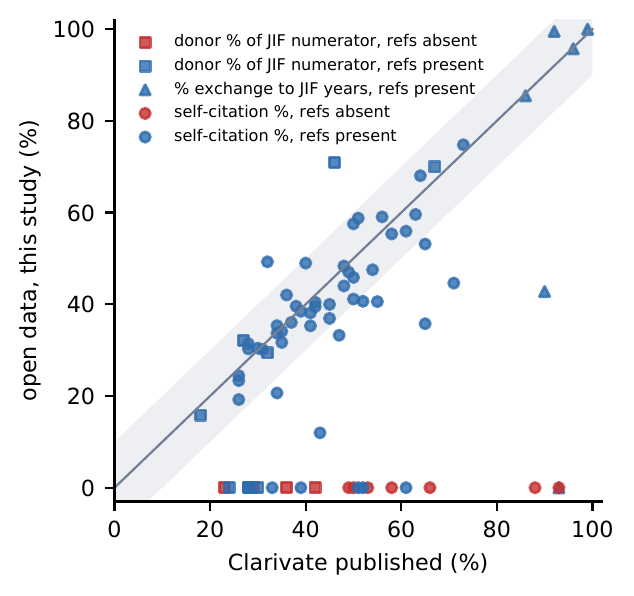
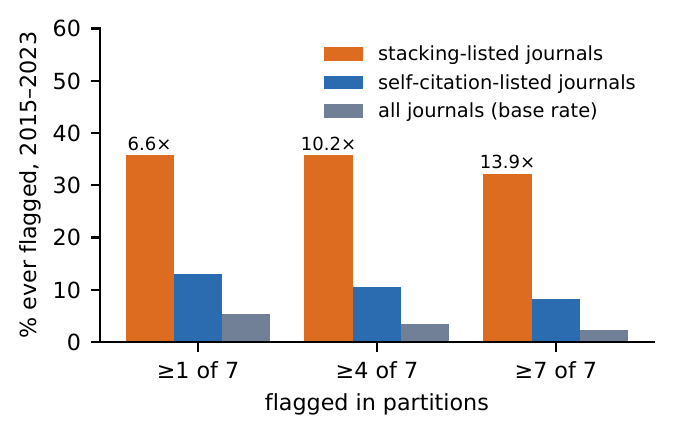
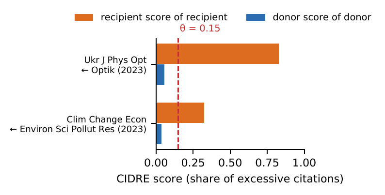
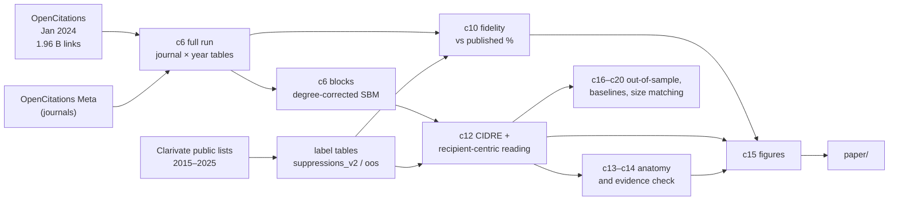

<h1 align="center">📚 Citation stacking on open data</h1>

<p align="center">
  <em>Can open citation data detect citation stacking? An audit against Clarivate's journal suppressions</em>
</p>

<p align="center">
  
  
  
  
  
</p>

Companion repository to the paper by **Hossein Mohasel Arjomandi** (manuscript submitted for publication). It holds
the label tables, all code, every run record with checksums, a map from each number in the paper to the run that
produced it, and the LaTeX source.

---

## 🧭 In one paragraph

Clarivate suppresses journals from the Journal Citation Reports when self-citations or concentrated citations from
another journal ("citation stacking") distort their Journal Impact Factor, but its data are closed. This project builds
yearly journal citation networks from the **open OpenCitations snapshot of January 2024** and audits them against
Clarivate's suppression lists for **data years 2015–2023**, collected from primary sources, with a prospective check
on **2024–2025**. It asks how well open data reproduce Clarivate's published figures, why the leading open method
(CIDRE) misses Clarivate's named stacking pairs, and whether a recipient-centric reading of CIDRE's own test does
better.

## 📊 Results at a glance

| | |
|---|---|
| Citations / journals in the open network | **1.96 billion** / **85,437** |
| Clarivate suppressions collected (data years 2015–2023) | 144 rows, every one with a primary source |
| Self-citation shares reproduced within 10 points (journals whose references are open) | **36 of 50** (0 of 7 when references are missing) |
| CIDRE detections among Clarivate's named stacking pairs | **0 of 15** (it drops large donor journals) |
| Recipient-centric reading: stacking-listed journals flagged vs other journals | **6.6× – 13.9×** (by consensus level) |
| … vs size-matched controls | 5× – 7× |
| … vs a plain 43% donor-share rule at the same flag rate | 10 vs 3 of 28 listed journals |
| Prospective check on the 2024–2025 lists | same direction, not significant (1 of 6) |
| Flagged pairs vs matched pairs: citations per citing paper / title similarity | 1.98 vs 1.28 / 0.084 vs 0.133 |

**Take-away:** open audits of journal-level citation manipulation are feasible, as long as coverage gaps (publishers
that do not deposit references, dataset-download citations) are measured and reported. Every number above is traced
in [`FINDINGS.md`](FINDINGS.md).

<p align="center">
  
  &nbsp;
  
</p>
<p align="center">
  
</p>
<p align="center"><sub>Previews of paper figures F2, F4 and F3 (PNG renderings of the PDFs in <code>paper/figures/</code>).</sub></p>

## 🗂️ What is in here

| Path | What it holds |
|---|---|
| `data/suppressions_v2.csv` | Clarivate suppressions, data years 2015–2023, transcribed from Clarivate's public lists (built by `data/build_suppressions_v2.py`) |
| `data/suppressions_oos.csv` | Suppressions for data years 2024–2025, used only for the out-of-sample test (built by `data/build_suppressions_oos.py`) |
| `data/suppressions_crosscheck.csv` | Cross-check of `suppressions_v2.csv` against Clarivate's current consolidated spreadsheet |
| `data/suppression_sources/SOURCES.md` | Every Clarivate source used: URL, web-archive link where one exists, SHA-256 of the copy used |
| `experiments/c01_journal_graph/` | All analysis scripts, `config.yaml`, `requirements.lock.txt`, the lab notebook `RESULTS_LOG.md` and `MANIFEST.md` (what each script does) |
| `experiments/c01_journal_graph/runs/` | One folder per run: `run.json` (parameters, input checksums, row counts, runtime), `log.txt`, outputs, `SHA256SUMS` |
| `FINDINGS.md` | Map from every number in the paper to the run and file that produced it |
| `paper/` | LaTeX source, figures and built PDFs (`main.pdf`; Scientometrics version in `paper/journals/scientometrics/`) |
| `vm/` | Scripts and environment for the steps that need a large machine (64 GB RAM) |
| `lit/` | Literature-search records used for the related-work section |
| `CITATION.cff` | How to cite this repository |

Clarivate's own files (spreadsheets, help pages, PDFs) are **not redistributed**. To rebuild the label tables, download
them from the URLs in `data/suppression_sources/SOURCES.md` to the paths listed there and check the checksums.

## 🔁 How the pipeline fits together



## ⚡ Quick start

**On a laptop (minutes, no large data):**

```bash
pip install -r experiments/c01_journal_graph/requirements.lock.txt

# 1. verify the committed run records (large parquet outputs are not in git, hence --ignore-missing)
ok=1; for d in experiments/c01_journal_graph/runs/*/; do [ -f "$d/SHA256SUMS" ] || continue
  (cd "$d" && sha256sum -c --quiet --ignore-missing SHA256SUMS) || ok=0; done; [ $ok = 1 ] && echo "all runs OK"

# 2. redraw the paper's figures F1–F6 from the committed run outputs
cd experiments/c01_journal_graph && python c15_figures.py --run-id my_rebuild && cd -

# 3. build the paper (Tectonic or any XeLaTeX)
cd paper && tectonic -X compile main.tex
```

**Full pipeline:**

1. **Environment.** Laptop steps: Python with the packages in `experiments/c01_journal_graph/requirements.lock.txt`
   (DuckDB, pandas, pyarrow, cidre 0.0.1). Block-model steps: the conda environment in `vm/environment.yml`
   (graph-tool is not on PyPI; the exact build is in `vm/environment.lock.yml`).
2. **Large-machine steps** (`vm/run_all.sh`; procedure in `vm/README.md`): `c6_full_run.py` turns the input files into
   journal-level yearly tables, and `c6_blocks.py` fits the degree-corrected stochastic block models.
3. **Analyses** (laptop, in `experiments/c01_journal_graph/`): `c9_scores.py` (journal-year scores), `c10_*`
   (label matching and fidelity), `c12_*` (CIDRE, the recipient-centric variant, enrichment, stability),
   `c13_*`/`c14_*` (paper-level anatomy and evidence check), `c16_*`–`c20_*` (out-of-sample test, baselines, size
   matching, asymmetric thresholds, paired tests), and `c15_figures.py` (paper figures). `MANIFEST.md` describes each
   script and `RESULTS_LOG.md` records each run in order.

Each script writes a new run folder and never overwrites an earlier one. Runs replaced by a later version carry a
`SUPERSEDED.txt` and are not cited in the paper.

## 📥 Data sources

| Source | Used for | Access | Terms |
|---|---|---|---|
| Parsed OpenCitations snapshot, Jan 2024 | citation graph | Illinois Data Bank, [doi:10.13012/B2IDB-5216575_V1](https://doi.org/10.13012/B2IDB-5216575_V1): `open_citations_jan2024_iid_el.csv.gz`, `open_citations_jan2024_pubs.csv.gz` | CC BY 4.0 |
| OpenCitations Meta CSV dump | journals and ISSNs | figshare, [doi:10.6084/m9.figshare.21747461.v7](https://doi.org/10.6084/m9.figshare.21747461.v7) (fetched by `vm/download_meta.sh`) | CC0 |
| Clarivate JCR suppression lists | labels | public Clarivate pages and files, listed in `data/suppression_sources/SOURCES.md` | not redistributed |

The two OpenCitations inputs are not included because of their size.

## 🤝 How to read the flag lists

Some run outputs (e.g. `flags.csv`, `consensus_flags.csv`, `groups.csv`) list journals that a statistical screen
flagged for an **anomalous citation pattern** in a given year. This includes journals that Clarivate never listed.

- A flag is a **candidate for expert review, not a finding of misconduct** or of any intent to manipulate. Many flags
  have benign explanations, such as a society journal and its companion, editorial preferences, regional research
  communities, or gaps and artifacts in the open data (see Section 5 of the paper).
- Flags depend on the data snapshot (OpenCitations, January 2024), on missing reference lists, and on the stochastic
  block-model partition. They are not stable verdicts about a journal.
- The paper names only journals that Clarivate itself listed. Please do the same when reusing these files: do not
  present a flag as evidence against a journal, its editors or its authors.
- All analyses are at journal level. The files contain no author or editor names.

## 📝 Citation

Please cite the paper (details will be added on publication) and this repository; GitHub's *Cite this repository*
button uses [`CITATION.cff`](CITATION.cff).

## ⚖️ Licences

- Code (`*.py`, `*.sh`): [MIT](LICENSE).
- Data tables, run records, figures and documentation: [CC BY 4.0](LICENSE-DATA).
- Clarivate's material is not covered and is not included. The input datasets keep their own licences.

## ✉️ Contact

Hossein Mohasel Arjomandi, hosseinm@microsoft.com. The views expressed here are the author's own and do not
necessarily reflect those of Microsoft.
